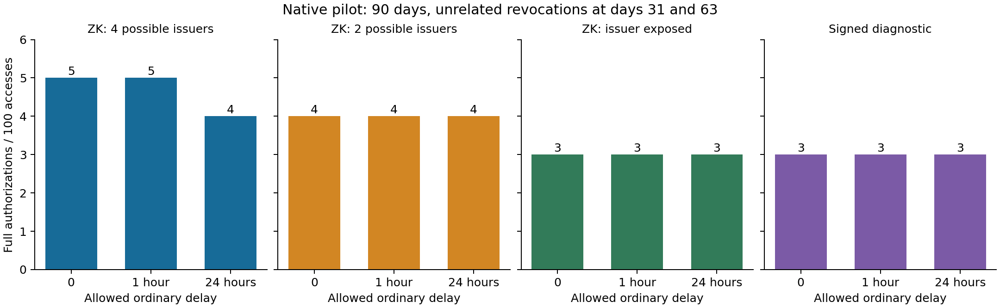
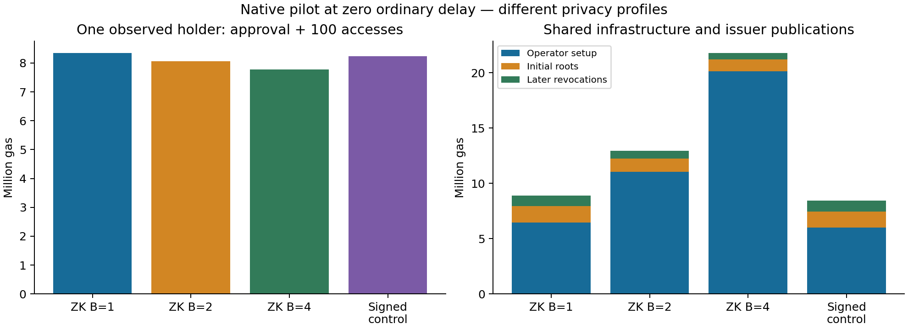

> Optional evidence note. Original source paths and rerun commands are retained as provenance; executing them needs the separate source repository. Nataliya does not need to run them.

# ECON-08 native pilot: observed results

Scope note, 13 November recovery: this document describes the original native pilot. The subsequently completed cohort is documented in [COHORT.md](COHORT.md); the local status component is in status-list/README.md (source-package locator: `status-list/README.md`; not required for this checkpoint). The later stages listed below are the pilot-time assessment, not the current completion list. See [README.md](../../START_HERE.md) for current scope.

The complete native replay passed on 13 November 2026. These are new measurements under protocol v0.1, not a reuse of the previous B=1/2/4 data.

- 32 independent fresh-chain scenarios: 24 main runs plus 8 no-update controls.
- 1,616 normal access transactions; 54 deliberately rejected transactions in separate correctness traces.
- 332 recorded check entries, including repeated partition checks; this is not 332 distinct security properties.
- 87 replay proofs and 33 timing proofs independently verified (30 measured and 3 warm-ups); public-input tampering was rejected.
- Ten model/audit regression tests passed, including deliberately corrupted summaries, dropped publications and false cache events.

## What changed when ordinary revocation delay changed

The table counts full authorizations, including the first, per 100 accesses. Every other access is a cache hit. The same holder stays eligible throughout the normal workload.

| Mechanism | Delay 0 | Delay 1 hour | Delay 24 hours | Potential issuer set |
|---|---:|---:|---:|---|
| ZK B=1 | 5 | 5 | 4 | 4, conditional on metadata |
| ZK B=2 | 4 | 4 | 4 | 2, conditional on metadata |
| ZK B=4 | 3 | 3 | 3 | 1: issuer exposed |
| Signed control | 3 | 3 | 3 | Issuer/credential ID exposed |

LOW needs one full authorization in every configuration. The no-update HIGH controls need three in every mechanism. All normal runs use eight issued synthetic credentials and one observed holder; the two scheduled publications are still counted in LOW.

The hour-long delay does not remove a renewal at this access cadence. For B=1, a 24-hour delay defers one renewal and changes the alignment of the next TTL expiry, reducing the count from five to four. This is conditional on this declared schedule, not an average workload or a universal benefit. The price is allowing an own-revoked cached authorization before the explicit deadline. Exact deadline rejection and non-extension by later updates passed.

## Actor gas at zero ordinary delay

Shared infrastructure is reported separately from the one holder. The right-hand components cover all configured groups. Gas is a resource quantity, not euros or observed mainnet fees.

| Mechanism | Holder: approval + 100 accesses | Operator setup | Initial issuer roots | Two later revocations |
|---|---:|---:|---:|---:|
| zk_B1 | 8,348,275 | 6,472,975 | 1,460,404 | 980,636 |
| zk_B2 | 8,060,136 | 11,044,408 | 1,196,574 | 725,354 |
| zk_B4 | 7,774,773 | 20,140,288 | 1,064,658 | 597,712 |
| signed_control | 8,227,671 | 5,984,123 | 1,460,404 | 980,636 |

More groups reduce this holder's unrelated renewals but increase shared deployment and reveal more about the issuer. Summing one holder with all shared deployment does not establish population cost or a break-even population. The signed control retains the common registry boundary and has different privacy; it is not a minimum-cost standalone signed system.

Mock-token deployment and the one-unit gate bootstrap are recorded but excluded. Rejected/correctness traces are excluded from this table. Issuance, witness delivery, hosting and other unmeasured costs remain unknown.

## Timing on this machine

Three sequential fresh Node processes, one fixed synthetic input and one setup: 10 measured observations and one excluded warm-up per process. The verification operation here is off-chain Groth16 verification, not network transaction latency. p95 uses empirical nearest rank.

| Operation | n | p50, ms | p95, ms | Per-session medians, ms |
|---|---:|---:|---:|---|
| Witness + proof | 30 | 1804.53 | 1985.06 | 1845.04, 1785.19, 1803.69 |
| Off-chain verification | 30 | 14.96 | 21.57 | 14.58, 14.43, 17.69 |

Environment: AMD EPYC 9V74 80-Core Processor, v24.22.1, Linux x64; local Hardhat Osaka EVM (chain 31337), Solidity 0.8.37+commit.f401782d.Emscripten.clang. Shared-host load and hardware differences are not estimated. Warm-up verification times are stored and excluded explicitly.

## Interpretation and handoff

The first technical dataset is ready for Nataliya's design note and K01–K16 mapping. Start from `summary.csv` and use `cost_ledger.csv` to trace each category to receipts. Keep payment allocation separate from resource cost and attach prices only as explicit assumptions.

A new publication is not yet ready. The active [v0.4 plan](../IMPLEMENTATION_PLAN_V04.md) first requires an early scientific go/no-go check, then exact event-model validation and a focused funding/liquidity study with one active-wallet EVM anchor. External PRC adapters and W3C gas comparisons are outside that campaign. This pilot establishes a reproducible starting point and demonstrates where delay affects work; it does not establish user unlinkability, adoption, profitability, post-quantum security or production readiness.

The proof setup is experimental. The recorded source commit, exact file hashes, raw evidence and reproduction commands are in [README.md](../../START_HERE.md).
